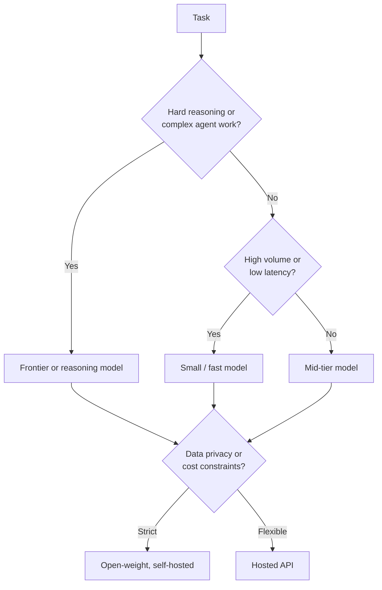

# What is an Agent ?

In agentic AI, an agent is a software system that uses a model, usually an LLM, to pursue a goal on its own. It does this by perceiving its environment, deciding what to do, taking actions, and adjusting based on the results. A plain LLM call maps one prompt to one response. An agent runs a loop and can act on the world.

### Key characteristics

-  Autonomy: it decides which steps to take without a human scripting each one.
-  Goal-directed: it works toward an outcome, not a single reply.
-  Tool use: it can change external systems, not only generate text.
-  Adaptivity: it reacts to tool results and errors and changes its plan.
-  Statefulness: it carries context across steps, and sometimes across sessions.

Model (the "brain")	Reasons, plans, and decides the next step.

# What is Agentic AI ?

Agentic AI is AI that can pursue a goal on its own. It plans, takes actions, checks the results, and adjusts until the goal is met. Generative AI mostly responds to a prompt. Agentic AI acts toward an outcome.

### What makes AI "agentic"
-  Goal-driven: you give it an objective, such as "resolve this support ticket", and not just a question.
-  Autonomous: it decides the steps itself, with little or no human direction at each one.
-  Tool use: it calls APIs, runs code, searches, queries databases, and so changes things outside the model.
-  Reasoning and planning: it breaks a goal into subtasks and orders them.
-  Feedback loop: it observes what happened, handles errors, and revises its plan.
-  Memory: it keeps context across steps and sometimes across sessions.

# What is MCP server ?

An MCP server is a program that exposes tools, data, and prompts to AI applications through the Model Context Protocol (MCP). MCP is an open standard introduced by Anthropic for connecting LLM apps and agents to external systems in one consistent way.

Without MCP, every AI app needs its own custom integration for every tool (GitHub, Slack, a database, and so on). With MCP, you write one server per tool, and any MCP-compatible client can use it. People often compare it to USB-C for AI integrations.

# What is RAG ?

RAG (Retrieval-Augmented Generation) is a pattern where an LLM is given relevant information retrieved from an external knowledge source at query time, and it answers using that information. The model's training data alone is not enough for private, recent, or domain-specific knowledge, and RAG addresses that gap. It also reduces hallucinations and lets you cite sources, and you can update knowledge without retraining.

### How RAG works
1. Ingest: load documents (PDFs, wikis, tickets, code).
1. Chunk: split them into smaller pieces.
1. Embed: convert each chunk to a vector that captures its meaning.
1. Store: save the vectors and metadata in a vector database (or a hybrid keyword and vector index).
1. Retrieve: embed the user's question and find the most similar chunks.
1. Generate: put the retrieved chunks in the prompt and have the LLM answer from them.

# What is Chunking ?

Chunking is splitting source documents into smaller segments before embedding and indexing them. It is needed because:

+ Embedding models and LLMs have context limits.
+ A vector for a whole 50-page document is too diluted to match a specific question.
+ Smaller, focused pieces give more precise retrieval and use fewer prompt tokens.

### Tuning considerations

+ Chunk size: too small loses context. Too large dilutes relevance and wastes tokens. A common starting point is 200-800 tokens.
+ Overlap: typically 10-20% so ideas that span a boundary are not lost.
+ Metadata: store the source, title, section, and page with each chunk for filtering and citations.
+ Content type: tables, code, and prose each need different handling.
+ Evaluate: measure retrieval quality (hit rate, recall) and answer quality, and adjust the settings.

### Failure modes

+ Poor chunking splits the answer across chunks, or buries it in noise.
+ Retrieval misses the relevant chunk, so the model answers without it or guesses.
+ Too many irrelevant chunks distract the model.
+ Stale or incorrect source data leads to wrong answers.

# What is Guardrails ? why it is required ?

Guardrails are controls placed around an AI system that check, constrain, or block what goes into and comes out of the model, and what actions an agent may take. They keep the system within safety, security, quality, and policy limits, even though the model itself is probabilistic and can't be fully trusted to behave.

### Why they are required
1. Models are non-deterministic. The same input can produce different outputs, and prompt instructions alone are not a reliable enforcement mechanism.
1. Hallucinations. Models can state false things confidently. Groundedness checks and citations reduce the risk.
1. Prompt injection and jailbreaks. Malicious instructions can arrive from users, web pages, documents, or tool results. This is a top risk for agents and RAG systems.
1. Data leakage. Models can expose PII, secrets, or confidential data from prompts, retrieved documents, or training data.
1. Agents can act. In agentic AI a wrong decision is no longer just bad text. It can delete data, send emails, or spend money. Errors can also compound over many steps.
1. Harmful or inappropriate content. Toxic, biased, or unsafe responses create user harm and reputational risk.
1. Compliance and governance. Regulations and internal policies (GDPR, HIPAA, the EU AI Act, corporate security standards) require controls, audit trails, and accountability.
1. Cost and abuse control. Limits on tokens, loops, and request rates prevent runaway usage and denial of service.
1. Trust and consistency. Predictable, on-policy behavior is needed before putting AI in front of customers or connecting it to production systems.

### How they are implemented
+ Rule-based: regexes, allow and deny lists, JSON schema validation. These are fast and deterministic.
+ Classifier or model-based: a smaller model or an LLM-as-judge scores toxicity, injection risk, or groundedness.
+ Structural controls: sandboxing, least-privilege credentials, network restrictions, and human-in-the-loop approvals. These are the most reliable for agents because they don't depend on the model behaving well.
+ Tooling: examples include IBM watsonx.governance and Granite Guardian, NVIDIA NeMo Guardrails, Guardrails AI, and provider moderation APIs.

# What is Agent Harness ?

An agent harness is all the software around an LLM that turns it into a working agent. The model reasons and decides what to do next. The harness runs the loop, builds the context, executes tools, enforces limits, and records what happened.

The model alone can only produce text. It can't read a file, run a command, remember what it did ten steps ago, or stop itself from doing something destructive. The harness provides all of that.

### Why it matters
+ Same model, different results. Tool design, prompt structure, and context handling often affect reliability more than a small model upgrade.
+ Reliability and safety live here. The model can't enforce permissions or limits on itself, so the harness does.
+ Cost and latency. Context compaction and caching decisions are made in the harness.
+ Evaluation depends on it. Agent behavior is a property of model plus harness, so evals must pin down both. Changing the harness changes the results.

### Examples
+ Claude Code, Cursor, and Codex CLI are coding-agent harnesses.
+ Frameworks like LangGraph, the OpenAI Agents SDK, and CrewAI help you build your own.

# What are the type of models that are available ?

Models can be grouped by capability tier, by openness, by size, by modality, and by purpose. These groupings overlap, so one model fits in several of them.

## 1. By capability tier

| Type | Meaning | Typical traits |
|---|---|---|
| **Frontier models** | The most capable models available at a given time, pushing the state of the art | Largest scale, best reasoning, coding, and tool use. Highest cost and latency. Usually accessed through an API. Examples: the top GPT, Claude, and Gemini models |
| **Near-frontier / flagship** | Slightly behind the leading edge, often cheaper | Strong general capability at a lower price |
| **Mid-tier / balanced** | Good quality at moderate cost and speed | Common default for production workloads |
| **Small / fast / "mini" or "flash"** | Optimized for speed and cost | Good for classification, extraction, routing, and high-volume tasks |
| **Tiny / on-device** | Run on laptops, phones, or edge hardware | Low latency, private, limited capability |

"Frontier" is relative. Today's frontier model becomes next year's mid-tier model.

## 2. By openness

| Type | Description | Trade-offs |
|---|---|---|
| **Closed / proprietary** | Weights are not public. You use them through an API. | Top capability and easy to use, but vendor lock-in and data leaves your environment |
| **Open-weight** | Weights are downloadable, and the license varies. Examples: Llama, Mistral, Qwen, IBM Granite. | You can self-host, fine-tune, and keep data private. You manage the infrastructure. |
| **Open-source (strict sense)** | Weights, code, and often training data and recipe are open under an OSI-style license | Maximum transparency. Few models qualify. |

Most "open" models are really open-weight, so check the license for commercial use. IBM Granite is released under Apache 2.0.

## 3. By size and architecture

- **Parameter count:** small (about 1-10B), medium (about 10-70B), large (hundreds of billions or more). More parameters usually means more capability, but more cost.
- **Dense vs. Mixture-of-Experts (MoE):** a dense model uses all parameters for every token. An MoE model routes each token to a few "expert" sub-networks, so it has a large total size but a lower per-token cost.
- **SLM vs. LLM:** small language models are increasingly used for specific tasks and in agents where cost and latency matter.

## 4. By modality

- **Text-only LLMs**
- **Multimodal models** that take or produce text, images, audio, and video
- **Vision-language models (VLMs)** for image understanding
- **Image generation** (diffusion models), **speech** (ASR and TTS), **video generation**
- **Embedding models**, which turn content into vectors for search and RAG
- **Rerankers**, which reorder retrieved results

## 5. By purpose or training

| Type | Purpose |
|---|---|
| **Base / foundation model** | Pretrained on large data and predicts the next token. A starting point for everything else. |
| **Instruction-tuned / chat** | Fine-tuned to follow instructions and converse. |
| **Reasoning models** | Trained to spend extra "thinking" tokens on multi-step problems (math, code, planning). Slower and costlier, but better on hard tasks. |
| **Code models** | Specialized for code generation and review. |
| **Domain-specific / fine-tuned** | Adapted to areas like legal, medical, or finance, or to your own data. |
| **Guard / safety models** | Classify or filter content, such as Granite Guardian. They are used for guardrails. |
| **Agentic / tool-use models** | Tuned for reliable function calling and long multi-step tasks. |

## How to choose

- Use a **frontier model** for complex reasoning, planning, and coding agents.
- Use **small models** for routing, classification, extraction, and guardrail checks.
- Use **open-weight models** when you need data control, customization, or lower cost at scale.
- Many production systems **mix models**, using a large one to plan and small ones to execute.
- Whichever you choose, **evaluate on your own tasks**. Leaderboard rankings don't always predict performance on your workload.
